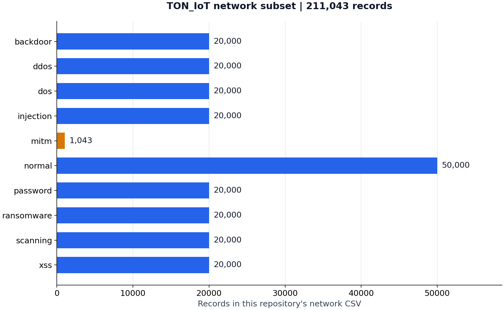

<p align="center">
  
</p>

<p align="center">
  <b>한국어</b> · <a href="README.md">English</a> ·
  <a href="#실험-결과">실험 결과</a> ·
  <a href="#실행-방법">실행 방법</a> ·
  <a href="https://github.com/M3rcy1028/zt-iot-security">통합 보안 시스템</a>
</p>

<p align="center">
  
  
  
</p>

## 연구 소개

**TON_IoT의 네트워크 특징을 입력으로 사용하는 LightGBM 이상행위 탐지 모델**을 학습하고 평가하는 저장소이다. Macro-SAGE 기반 전역 핵심 특징에 클래스별 SHAP과 근사 조건부 순열 특징 중요도(CPFI)를 결합하여, 공격 유형별 식별 정보를 보존하면서 입력 특징을 축소한다.

이 연구는 **네트워크 특징 수를 줄이면서 탐지 성능을 유지하고 모델의 저장·처리 부담을 낮출 수 있는가**를 확인한다. 22·18·16개 특징 모델을 비교하고, 추가적인 14개 특징 축소가 거부된 이유까지 기록하였다. 18개 특징 모델은 [제로 트러스트 IoT 보안 시스템](https://github.com/M3rcy1028/zt-iot-security)의 내부 서버에 연결되어 장치별 접근 판단에 분석 결과를 제공한다.

> **브랜치 안내:** 현재 문서의 학습·XAI·실험 결과는 `xai` 브랜치에 있다. 기본 `main`에는 이전 구현과 최신 실험으로 연결되는 안내 문서가 있다. 아래 수치의 원본은 [`c8cc8596`](https://github.com/M3rcy1028/toniot-ids/tree/c8cc8596f22900d994eca525878c8c674e2e98e4)에 저장된 실험 자료이며, 이후 문서 수정 과정에서 모델을 재학습한 값이 아니다.

## 실험 흐름


1. IP·포트와 이진 정답 `label`, `-` 비율이 95% 이상인 열을 제거하고, 남은 `-` 값을 `unknown`으로 대체한다.
2. CSV를 셔플한 뒤 학습·검증·테스트로 계층 분할한다. 범주형 인코더와 MinMax 스케일러는 학습 자료로 적합한다.
3. 22개 특징의 LightGBM 기준 모델을 학습한다. 학습 집합으로 Macro-SAGE, 클래스별 SHAP, CPFI 및 SHAP 상호작용을 계산한다.
4. 전역 핵심 특징과 공격 유형별 중요 특징을 보존하여 축소 후보를 구성하고, 재학습 후 검증 집합의 채택 조건을 확인한다.
5. 조건을 통과한 후보를 저장된 테스트 집합에서 평가하고, 모델·전처리 자료·입력 순서·예측값·보고서를 저장한다.

현재 결측 비율 기준의 열 제거는 **분할 이전**에 수행된다. 범주형 인코딩과 스케일링은 학습 집합으로 적합하고, 검증 집합은 조기 종료와 채택 판단에 사용한다. 이 구성의 평가 범위는 [하단](#평가-범위)에 정리하였다.

## 데이터셋

[UNSW의 TON_IoT 원본 자료](https://research.unsw.edu.au/projects/toniot-datasets)는 네트워크, 운영체제 및 IoT·IIoT 텔레메트리로 구성된다. **이 실험은 네트워크 CSV만 사용**하며, 코드의 다운로드 경로는 [Kaggle 미러](https://www.kaggle.com/datasets/arnobbhowmik/ton-iot-network-dataset)이다.

| 항목 | 설정 |
| --- | --- |
| 입력 파일 | `data_network/raw/train_test_network.csv` |
| CSV 규모 | 정답 열을 포함한 **211,043행 × 44열** |
| 예측 대상 | `type`: 정상 1종 + 공격 9종 |
| 학습 / 검증 / 테스트 | **147,729 / 31,657 / 31,657건** |
| 분할 방식 | 계층 분할 70% / 15% / 15%, 난수 시드 `42` |
| 기준 → 배포 입력 | **22 → 18개 특징** |
| 다른 정답 열 | 이진 `label`은 다중분류 입력에서 제외 |

위 규모는 **본 저장소의 CSV 표본**이며 TON_IoT 전체 자료의 규모를 의미하지 않는다.

| 유형 | 전체 CSV | 학습 | 검증 | 테스트 |
| --- | ---: | ---: | ---: | ---: |
| backdoor | 20,000 | 14,000 | 3,000 | 3,000 |
| ddos | 20,000 | 14,000 | 3,000 | 3,000 |
| dos | 20,000 | 14,000 | 3,000 | 3,000 |
| injection | 20,000 | 14,000 | 3,000 | 3,000 |
| mitm | 1,043 | 729 | 157 | 157 |
| normal | 50,000 | 35,000 | 7,500 | 7,500 |
| password | 20,000 | 14,000 | 3,000 | 3,000 |
| ransomware | 20,000 | 14,000 | 3,000 | 3,000 |
| scanning | 20,000 | 14,000 | 3,000 | 3,000 |
| xss | 20,000 | 14,000 | 3,000 | 3,000 |
| **합계** | **211,043** | **147,729** | **31,657** | **31,657** |



## XAI 기반 특징 축소

| 구성 | 특징 선택에서의 역할 |
| --- | --- |
| Macro-SAGE | 저장소에서 계산한 클래스별 SAGE를 균등 집계하여 전역 핵심 특징을 선정 |
| 클래스별 SHAP | 전체 평균에 가려질 수 있는 개별 공격 유형의 중요 특징을 확인 |
| 근사 CPFI | 상관된 특징으로 구성한 그룹 안에서 순열을 수행하고 클래스별 F1 변화를 측정 |
| SHAP 상호작용 | 특징 쌍의 기여를 확인하고 선택 과정의 유형별 특징 보존을 보조 |
| LIME | 선택적으로 실행 가능하나, 저장된 자동 축소 실험에서는 **비활성화·선택 제외** |

첫 축소는 Macro-SAGE 상위 14개를 핵심으로 사용한다. 클래스별 SHAP·CPFI 상위 12개 순위와 유형별 최소 3개 후보 특징의 포함 조건을 결합한다. CPFI는 5회 반복·조건 특징 2개·구간 5개를 사용하고 SAGE는 1회 반복한다. 구성한 18–20개 특징 후보를 재학습한 뒤 검증 집합에서 채택 여부를 판단한다. 전체 설정은 [`xai_config.json`](reports/lightgbm_260805/xai/reduction_1/xai_config.json)에 있다.

### 최종 18개 입력 특징

[저장된 목록](reports/lightgbm_260805/xai/reduction_1/selection/final_selected_features.csv)에 따른 **모델 입력 순서**는 다음과 같다.

```text
proto, service, duration, src_bytes, dst_bytes, conn_state,
src_pkts, src_ip_bytes, dst_pkts, dst_ip_bytes,
dns_query, dns_qclass, dns_qtype, dns_rcode,
dns_AA, dns_RD, dns_RA, dns_rejected
```

22개 기준 특징에서 `missed_bytes`, `http_request_body_len`, `http_response_body_len`, `http_status_code`를 제거하였다.

### 저장된 중요도 그림

아래는 **첫 축소 이전 22개 특징 선택 모델**의 상위 20개 중요도이다. 배포 모델이 요청마다 생성한 설명이 아니라, 오프라인 특징 선택의 근거이다.


## 실험 결과

### 테스트 집합의 분류 성능

아래 모델은 동일한 **31,657건의 테스트 집합**에서 평가하였다. Precision·Recall·F1은 **10개 클래스의 비가중 Macro 평균**이다. 분류 지표의 단위는 %이다.

| 모델 | 입력 특징 | Accuracy | Macro Precision | Macro Recall | Macro F1 |
| --- | ---: | ---: | ---: | ---: | ---: |
| 기준 모델 | 22 | 97.7920 | 95.3154 | 95.2816 | 95.2795 |
| **축소 1 · 배포 모델** | **18** | **97.8172** | **95.5566** | **95.6200** | **95.5692** |
| 축소 2 | 16 | 97.8204 | 95.4429 | 95.6857 | 95.5419 |

원본: [기준 모델](reports/lightgbm_260805/metrics.csv), [18개 특징](reports/lightgbm_260805/reduction_1/metrics.csv), [16개 특징](reports/lightgbm_260805/reduction_2/metrics.csv).

### 모델 크기와 배치 처리 비용

| 모델 | 저장 모델 크기 (B) | 배치 시간 (s) | 건당 환산 시간 (ms) | 처리량 (건/s) |
| --- | ---: | ---: | ---: | ---: |
| 기준 · 22개 | 8,152,020 | 2.3505 | 0.07425 | 13,468.34 |
| **축소 1 · 18개** | **7,273,284** | **2.0422** | **0.06451** | **15,501.44** |
| 축소 2 · 16개 | 7,853,780 | 2.1702 | 0.06855 | 14,587.09 |

**측정 범위:** `evaluate_model()`의 시간에는 전체 테스트 배치에 대한 `predict(X_test)`와 `predict_proba(X_test)` **두 호출이 모두 포함**된다. 건당 시간은 배치 시간을 31,657로 나눈 값이다. 단일 요청 지연·특징 추출 시간·ESP32–서버 통신 지연과 구분해야 하며, 위 값은 기존 실험에서 저장한 측정값이다.


**결과 분석.** 18개 특징 모델은 기준 모델보다 입력 수가 **18.18%**, 저장 크기가 **10.78%**, 기록된 배치 평가 시간이 **13.12%** 감소하였다. Accuracy는 0.0253%p, Macro F1은 0.2897%p 증가하였다. 16개 모델의 Accuracy가 더 높으며 정답 수로는 1건 차이이다. 반면 18개 모델은 Macro F1이 더 높고 저장된 모델 크기와 해당 실행의 처리 시간이 더 작아 통합 시스템의 배포 모델로 사용하였다. 입력 수 감소가 곧 트리 수 감소를 의미하지는 않으며, 저장된 22·18·16개 모델은 각각 227·203·219회 부스팅에서 조기 종료되었다.

### 검증 조건과 추가 축소 결과

각 후보는 검증 집합에서 **직전 단계 모델**과 비교한다. 허용 감소 폭은 Accuracy **0.1%p**, Macro F1 **0.2%p**, MITM Recall **1.0%p** 이내이다.

| 후보 | 특징 수 | 검증 Accuracy (%) | 검증 Macro F1 (%) | 검증 MITM Recall (%) | 판단 |
| --- | ---: | ---: | ---: | ---: | --- |
| 기준 모델 | 22 | 98.0257 | 95.8059 | 78.9809 | 비교 기준 |
| 축소 1 | 18 | 98.0131 | 95.7370 | 78.3439 | 통과 |
| 축소 2 | 16 | 98.0320 | 95.8986 | 79.6178 | 통과 |
| 축소 3 | 14 | 97.9941 | 95.7218 | 78.3439 | **거부** |

14개 후보의 MITM Recall은 16개 모델보다 **1.2739%p 감소**하여 조건을 초과하였다. 이에 따라 해당 후보의 테스트 평가와 모델 저장은 수행되지 않았다. 18개와 16개는 모두 검증 조건을 통과하며, 통합 시스템의 배포 모델 선정은 이 검증 통과 여부와 별도의 선택이다. [1단계](reports/lightgbm_260805/reduction_1/acceptance_decision.csv)·[2단계](reports/lightgbm_260805/reduction_2/acceptance_decision.csv)·[3단계](reports/lightgbm_260805/reduction_3/acceptance_decision.csv) 판단 기록을 함께 제공한다.

### 배포 모델의 유형별 성능

| 유형 | Precision (%) | Recall (%) | F1 (%) | 테스트 표본 |
| --- | ---: | ---: | ---: | ---: |
| backdoor | 99.9667 | 100.0000 | 99.9833 | 3,000 |
| ddos | 99.0863 | 97.6000 | 98.3375 | 3,000 |
| dos | 99.0903 | 98.0333 | 98.5590 | 3,000 |
| injection | 98.3034 | 96.5667 | 97.4273 | 3,000 |
| mitm | 76.2500 | 77.7070 | 76.9716 | 157 |
| normal | 99.6006 | 99.7600 | 99.6803 | 7,500 |
| password | 99.3579 | 98.0000 | 98.6743 | 3,000 |
| ransomware | 90.8557 | 98.0333 | 94.3082 | 3,000 |
| scanning | 98.6415 | 99.2333 | 98.9365 | 3,000 |
| xss | 94.4138 | 91.2667 | 92.8136 | 3,000 |

전체 **31,657건 중 30,966건**을 정확하게 분류하였다. MITM은 테스트 표본이 157건이며 다른 유형보다 낮은 성능을 보인다. 가장 큰 비대각 오분류는 XSS 220건을 ransomware로 판단한 경우이다. 아래 정규화 그림과 [원본 건수 그림](reports/lightgbm_260805/reduction_1/confusion_matrix.png), [CSV](reports/lightgbm_260805/reduction_1/confusion_matrix.csv)를 함께 확인할 수 있다.


## 실행 방법

### 1. 실험 브랜치 다운로드와 환경 구성

```bash
git clone --branch xai --single-branch --depth 1 https://github.com/M3rcy1028/toniot-ids.git
cd toniot-ids
```

Windows PowerShell:

```powershell
py -3.14 -m venv .venv
.\.venv\Scripts\Activate.ps1
python -m pip install -r requirements-toniot.txt
```

Python 3.14가 설치된 Linux/macOS:

```bash
python3.14 -m venv .venv
source .venv/bin/activate
python -m pip install -r requirements-toniot.txt
```

통합 시스템에서 모델 로딩·추론을 확인한 인터프리터는 **CPython 3.14.4**이다. 기존 학습 실행의 정확한 Python 버전과 전체 장비 설정은 완전히 기록되어 있지 않다. 아래는 저장소의 고정 의존성 버전이며 장비가 달라도 동일한 시간이 측정된다는 의미는 아니다.

| 패키지 | 버전 | 패키지 | 버전 |
| --- | --- | --- | --- |
| lightgbm | 4.6.0 | scikit-learn | 1.8.0 |
| numpy | 2.4.3 | pandas | 3.0.1 |
| joblib | 1.5.3 | matplotlib | 3.10.8 |
| shap | 0.51.0 | sage-importance | 0.0.6 |
| lime | 0.2.0.1 | kagglehub | 1.0.1 |

### 2. 재학습 없이 저장 모델 사용

저장소 루트에서 아래 Python 코드를 실행한다. `X_test.csv`는 **인코딩·스케일링 완료 자료**이므로 전처리를 중복 적용하지 않는다.

```python
from pathlib import Path
import joblib
import pandas as pd

report = Path("reports/lightgbm_260805")
model = joblib.load("models/lightgbm_toniot_classification_reduction_1.pkl")
target = joblib.load("data_network/processed_type/target_encoder.pkl")
features = pd.read_csv(
    report / "xai/reduction_1/selection/final_selected_features.csv"
)["feature"].tolist()
X = pd.read_csv("data_network/processed_type/X_test.csv", nrows=5)[features]
labels = target.inverse_transform(model.predict(X).astype(int))
probabilities = model.predict_proba(X)
print(pd.DataFrame({"label": labels, "confidence": probabilities.max(axis=1)}))
```

`.pkl`에는 단순 가중치 배열이 아니라 **학습된 결정트리 앙상블**이 저장되어 있다. 원본 네트워크 입력은 저장된 `label_encoders.pkl`과 `minmax_scaler.pkl`을 먼저 적용한 뒤, 18개 특징의 순서를 맞춰야 한다. 온라인 입력 처리는 [통합 시스템의 서버 어댑터와 실행 안내](https://github.com/M3rcy1028/zt-iot-security)를 참고한다.

### 3. 오프라인 학습·축소 재현

새 작업 사본에서 실행한다. 학습 결과는 고정된 `models/` 파일명과 실행일 기준의 `reports/lightgbm_YYMMDD/`에 저장된다. 전체 학습 자료의 XAI 분석은 일반 모델 학습보다 긴 시간이 필요할 수 있다.

```bash
# XAI 분석을 제외한 기준 모델 학습·평가.
python -c "from experiment import run_lightgbm_pipeline; run_lightgbm_pipeline(save_results=True, feature_selection=False, run_xai=False)"

# 직전 단계의 실행일별 자료를 사용하므로 아래 순서로 실행.
python run_reduction_1.py
python run_reduction_2.py
python run_reduction_3.py
```

현재 스크립트는 프로세스 시작일로 보고서 경로를 결정한다. 의존하는 단계를 같은 날짜 문맥에서 실행해야 하며, 자정을 넘겨 다음 단계를 시작하면 새로운 날짜 폴더를 조회한다. README 수치는 기존 `lightgbm_260805` 폴더를 기준으로 한다.

전처리 CSV가 있으면 이를 재사용한다. 원본 CSV로 전처리 자료를 명시적으로 재생성하려면 다음을 실행한다.

```bash
python -c "from toniot_dataset import ensure_raw_dataset, preprocess_dataset; ensure_raw_dataset(); preprocess_dataset()"
```

원본 CSV가 없으면 `ensure_raw_dataset()`이 설정된 Kaggle 미러에서 다운로드하며, 접근 조건에 따라 Kaggle 인증이 필요할 수 있다. `python run.py`는 기본적으로 기준 모델과 **XAI 분석을 함께 실행**한다. 이 파일의 boolean 인자는 `type=bool`이므로, XAI를 끄려면 위 함수 호출 방식을 사용한다.

### 4. 저장 결과 대조와 README 그림 재생성

```bash
python docs/tools/build_readme_assets.py
```

세 모델의 예측 파일·혼동행렬·Macro 지표를 대조하고 자료 분포·모델 해시를 확인하여 문서 그림을 재생성한다. **재학습이나 새 추론 시간 측정은 수행하지 않는다.** 집계 결과는 [`docs/research_summary.json`](docs/research_summary.json)에 저장된다.

## 모델 설정과 파일 구성

다중분류 GBDT, 최대 3,000회 부스팅, 학습률 `0.05`, 리프 수 `31`, 최대 깊이 `15`, 특징 비율 `0.8`, 시드 `42`, CPU 스레드 `8`을 사용한다. 검증 `multi_logloss`가 50회 개선되지 않으면 조기 종료한다. 생성자에는 `subsample=0.8`도 있으나 `subsample_freq=0`이므로 행 배깅은 활성화되지 않는다. 설정 원본은 [`lightgbm_model.py`](lightgbm_model.py)이다.

```text
toniot-ids/
├── toniot_dataset.py        # 다운로드, 분할, 인코딩, 스케일링
├── lightgbm_model.py        # LightGBM 생성, 학습, 저장
├── experiment.py            # 기준 모델, 축소, 검증 조건, 평가
├── xai.py                   # 클래스별 중요도, 상호작용, 합의 특징 선택
├── run.py                   # 기본 모델·특징 선택 모델 진입점
├── run_reduction_{1,2,3}.py  # 단계별 축소 실험
├── requirements-toniot.txt  # 고정 의존성 버전
├── data_network/            # 현재 원본 CSV와 processed_type 분할 자료
├── models/                  # 학습된 전체·축소 모델
├── reports/lightgbm_260805/  # 기존 지표, 예측값, XAI, 특징 선택 근거
└── docs/                    # 집계 결과와 README 그림 재생성 도구
```

이전 `data/processed_label`·`data/processed_type`은 과거 실험 경로이다. 현재 다중분류 코드는 **`data_network/processed_type`**을 사용한다.

## 평가 범위

- 기록된 네트워크 특징의 지도학습 분류 결과이다. 실시간 패킷 수집, 원시 센서 텔레메트리의 이상탐지, 새로운 운용 환경의 일반화 성능을 입증한 결과와 구분한다.
- 행 단위 계층 분할이며 장치·시점·사이트를 분리한 평가가 아니다. 95% 결측 기준 열 제거는 분할 전에 수행되므로, 엄격한 귀납 평가에서는 이 필터도 학습 집합으로 결정할 필요가 있다.
- 특징 선택·검증에는 학습·검증 집합을 사용하지만, 배포 모델 비교에는 같은 테스트 집합의 여러 후보 결과도 제시한다. 최종 모델 선정 이후의 독립적인 성능 추정에는 별도의 외부 평가 집합이 필요하다.
- CPFI는 그룹 내 순열에 의한 조건부 샘플링의 근사이다. SAGE 1회 반복과 기존 단일 시간 측정만으로 선택 안정성이나 시간의 신뢰구간을 판단하지 않는다.
- MITM 표본이 적으므로 전체 Accuracy와 함께 Macro 지표와 클래스별 표본·Recall을 확인해야 한다.

## 참고 자료와 연계 구현

- [UNSW TON_IoT 제공처와 필수 인용 논문](https://research.unsw.edu.au/projects/toniot-datasets): 원 제공자의 인용·자료 이용 조건을 따른다. 다운로드 미러는 원 제작 기관과 구분한다.
- [LightGBM 4.6.0 공식 문서와 구현](https://lightgbm.readthedocs.io/en/v4.6.0/).
- [SHAP 공식 문서](https://shap.readthedocs.io/en/stable/) 및 [SAGE 저자들의 참조 구현](https://github.com/iancovert/sage). 본 실험의 클래스별 SAGE 집계와 합의 특징 선택은 저장소의 `xai.py`에 구현되어 있다.
- [LIME 저자들의 구현](https://github.com/marcotcr/lime): 선택적으로 사용할 수 있는 설명 경로이다.
- [제로 트러스트 IoT 보안 시스템](https://github.com/M3rcy1028/zt-iot-security): 본 모델을 장치–게이트웨이 인증 통신, 내부 서버 분석 및 장치별 위험 정책 집행과 연결한다.
