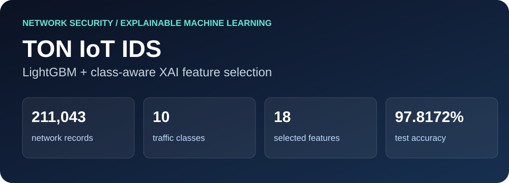
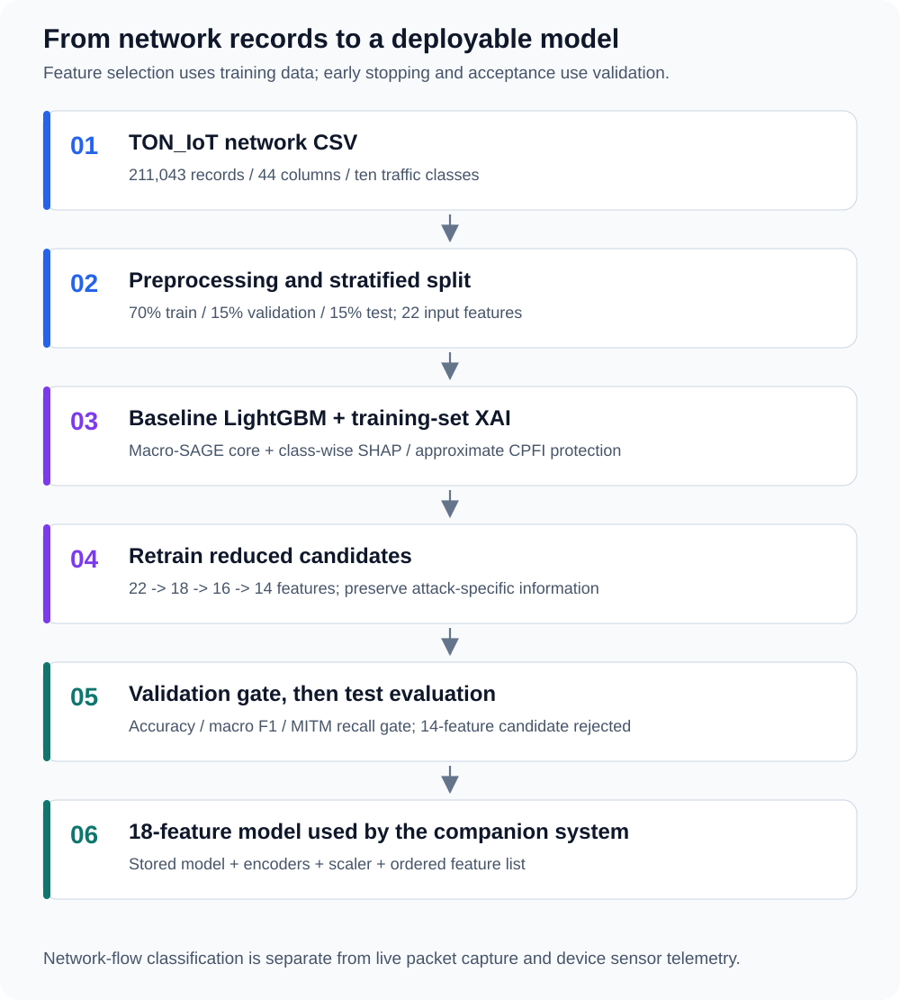
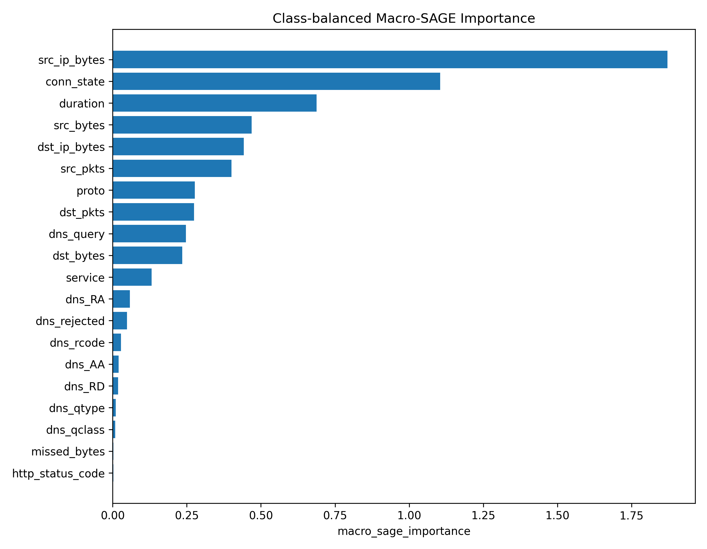
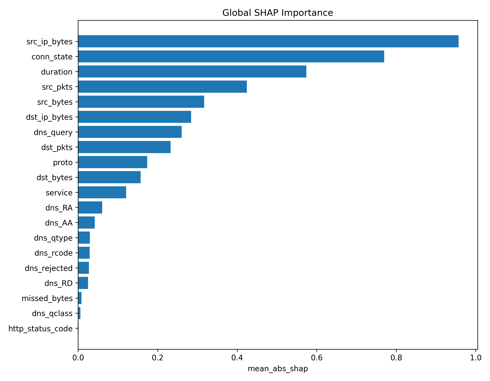
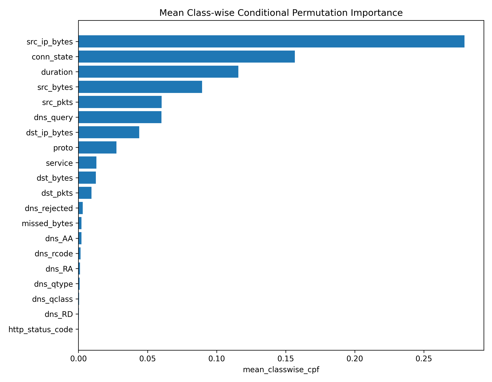
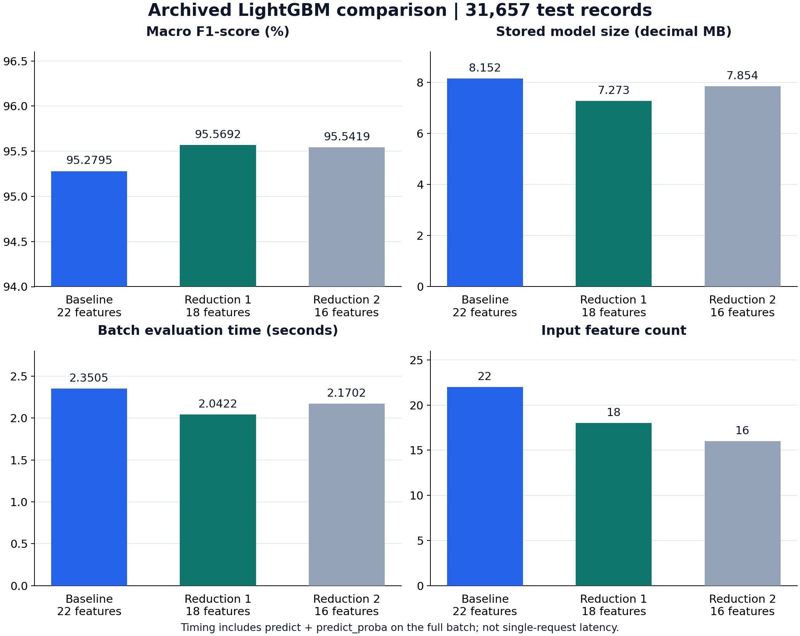
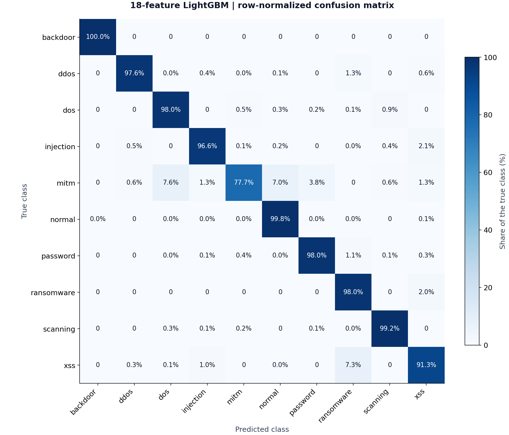

<p align="center">
  
</p>

<p align="center">
  <b>한국어</b> · <a href="README.md">English</a> ·
  <a href="#실험-결과">실험 결과</a> ·
  <a href="#실행-방법">실행 방법</a> ·
  <a href="https://github.com/M3rcy1028/zt-iot-security">통합 보안 시스템</a>
</p>

<p align="center">
  
  
  
</p>

## 연구 소개

**TON_IoT 네트워크 데이터를 이용한 LightGBM 이상행위 탐지 모델**의 학습·분석·평가 코드를 제공한다. Macro-SAGE, class-wise SHAP, approximate Conditional Permutation Feature Importance(CPFI)를 결합해 공격 유형별 주요 feature를 보존하면서 모델의 입력을 줄인다.

이 연구는 **탐지 성능을 유지하면서 입력 feature 수와 모델의 저장·처리 비용을 줄이는 것**을 목표로 한다. 22·18·16개 feature 모델을 비교하고, 14개까지 축소했을 때의 성능 변화도 분석하였다. 최종 18-feature 모델은 [제로 트러스트 IoT 보안 시스템](https://github.com/M3rcy1028/zt-iot-security)의 내부 서버에서 장치별 접근제어에 필요한 분석 결과를 제공한다.

## 실험 흐름



1. IP·포트와 binary label, `-` 비율이 95% 이상인 column을 제거하고 남은 `-`를 `unknown`으로 대체한다.
2. `stratified split`으로 train·validation·test set을 구성한다. Categorical encoder와 MinMax scaler는 training set을 기준으로 학습한다.
3. 22-feature baseline을 학습하고, training set에서 Macro-SAGE·class-wise SHAP·CPFI·SHAP interaction을 계산한다.
4. 전역 중요도와 공격 유형별 feature를 반영해 축소 후보를 구성한다. 후보를 재학습한 뒤 validation set에서 채택 조건을 확인한다.
5. 채택한 후보를 test set에서 평가하고 모델·전처리 파일·feature 목록·예측 결과를 생성한다.

## 데이터셋

[UNSW TON_IoT](https://research.unsw.edu.au/projects/toniot-datasets)는 네트워크 트래픽, 운영체제 로그, IoT·IIoT telemetry를 포함한다. 본 실험은 [Kaggle 미러](https://www.kaggle.com/datasets/arnobbhowmik/ton-iot-network-dataset)의 네트워크 CSV를 사용한다.

| 항목 | 설정 |
| --- | --- |
| 입력 파일 | `data_network/raw/train_test_network.csv` |
| CSV 규모 | label을 포함한 **211,043행 × 44열** |
| 예측 대상 | `type`: 정상 1종 + 공격 9종 |
| 학습 / 검증 / 테스트 | **147,729 / 31,657 / 31,657건** |
| 분할 방식 | Stratified split 70% / 15% / 15%, random seed `42` |
| Baseline → 배포 모델 | **22 → 18개 feature** |
| Binary label | 다중분류 입력에서 제외 |

| 유형 | 전체 CSV | 학습 | 검증 | 테스트 |
| --- | ---: | ---: | ---: | ---: |
| backdoor | 20,000 | 14,000 | 3,000 | 3,000 |
| ddos | 20,000 | 14,000 | 3,000 | 3,000 |
| dos | 20,000 | 14,000 | 3,000 | 3,000 |
| injection | 20,000 | 14,000 | 3,000 | 3,000 |
| mitm | 1,043 | 729 | 157 | 157 |
| normal | 50,000 | 35,000 | 7,500 | 7,500 |
| password | 20,000 | 14,000 | 3,000 | 3,000 |
| ransomware | 20,000 | 14,000 | 3,000 | 3,000 |
| scanning | 20,000 | 14,000 | 3,000 | 3,000 |
| xss | 20,000 | 14,000 | 3,000 | 3,000 |
| **합계** | **211,043** | **147,729** | **31,657** | **31,657** |


## XAI 기반 Feature Selection

| 구성 | 역할 |
| --- | --- |
| Macro-SAGE | 클래스별 SAGE를 동일 비중으로 집계해 전역 핵심 feature 선정 |
| Class-wise SHAP | 개별 공격 유형의 예측에 기여하는 feature 확인 |
| Approximate CPFI | 상관된 feature로 구성한 그룹 내부에서 값을 섞고 클래스별 F1 변화 측정 |
| SHAP interaction | Feature 쌍의 기여도와 유형별 중요 feature 확인 |
| LIME | 선택적으로 실행 가능, 본 실험 설정은 `enable_lime=false` |

첫 축소에서는 Macro-SAGE 상위 14개를 core feature로 사용한다. 여기에 클래스별 SHAP·CPFI 상위 12개와 유형별 최소 3개 후보의 포함 조건을 적용한다. CPFI 설정은 5회 반복·conditioning feature 2개·bin 5개이며, SAGE는 1회 반복한다. 18–20개 feature로 구성한 후보를 재학습하고 validation set에서 채택 여부를 판단한다. 전체 설정: [`xai_config.json`](reports/lightgbm_260805/xai/reduction_1/xai_config.json)

### 최종 18개 Feature

[Feature 목록](reports/lightgbm_260805/xai/reduction_1/selection/final_selected_features.csv)의 **모델 입력 순서**는 다음과 같다.

```text
proto, service, duration, src_bytes, dst_bytes, conn_state,
src_pkts, src_ip_bytes, dst_pkts, dst_ip_bytes,
dns_query, dns_qclass, dns_qtype, dns_rcode,
dns_AA, dns_RD, dns_RA, dns_rejected
```

22-feature baseline에서 `missed_bytes`, `http_request_body_len`, `http_response_body_len`, `http_status_code`를 제거하였다.

### Feature Importance

첫 축소에 사용한 **22-feature 모델의 상위 20개 feature importance**를 비교하였다.







## 실험 결과

### 분류 성능

동일한 **31,657건의 test set**에서 평가하였다. Precision·Recall·F1은 10개 클래스의 macro average이다. (단위: %)

| 모델 | Feature 수 | Accuracy | Macro Precision | Macro Recall | Macro F1 |
| --- | ---: | ---: | ---: | ---: | ---: |
| Baseline | 22 | 97.7920 | 95.3154 | 95.2816 | 95.2795 |
| **축소 1 · 배포 모델** | **18** | **97.8172** | **95.5566** | **95.6200** | **95.5692** |
| 축소 2 | 16 | 97.8204 | 95.4429 | 95.6857 | 95.5419 |

결과 CSV: [Baseline](reports/lightgbm_260805/metrics.csv) · [18-feature](reports/lightgbm_260805/reduction_1/metrics.csv) · [16-feature](reports/lightgbm_260805/reduction_2/metrics.csv)

### 모델 크기와 배치 처리 비용

| 모델 | 모델 크기 (B) | Batch time (s) | Time/sample (ms) | Throughput (samples/s) |
| --- | ---: | ---: | ---: | ---: |
| 기준 · 22개 | 8,152,020 | 2.3505 | 0.07425 | 13,468.34 |
| **축소 1 · 18개** | **7,273,284** | **2.0422** | **0.06451** | **15,501.44** |
| 축소 2 · 16개 | 7,853,780 | 2.1702 | 0.06855 | 14,587.09 |

`Batch time`은 전체 test set에 대한 `predict(X_test)`와 `predict_proba(X_test)`의 합계이다. `Time/sample`은 이를 31,657로 나눈 값이다.



**결과 분석:** 18-feature 모델은 baseline보다 입력 수가 **18.18%**, 모델 크기가 **10.78%**, batch time이 **13.12%** 감소하였다. Accuracy는 0.0253%p, Macro F1은 0.2897%p 증가하였다. 16-feature 모델의 Accuracy가 1건의 정답 차이로 더 높았으나, 18-feature 모델이 Macro F1·모델 크기·처리 시간에서 유리해 통합 시스템의 배포 모델로 선정하였다. 22·18·16-feature 모델의 early stopping 시점은 각각 227·203·219회였다.

### 검증 조건과 추가 축소 결과

Validation set에서 **직전 단계 모델**과 비교한다. 허용 감소 폭은 Accuracy **0.1%p**, Macro F1 **0.2%p**, MITM Recall **1.0%p** 이내이다.

| 후보 | Feature 수 | Validation Accuracy (%) | Validation Macro F1 (%) | Validation MITM Recall (%) | 판단 |
| --- | ---: | ---: | ---: | ---: | --- |
| 기준 모델 | 22 | 98.0257 | 95.8059 | 78.9809 | 비교 기준 |
| 축소 1 | 18 | 98.0131 | 95.7370 | 78.3439 | 통과 |
| 축소 2 | 16 | 98.0320 | 95.8986 | 79.6178 | 통과 |
| 축소 3 | 14 | 97.9941 | 95.7218 | 78.3439 | **미채택** |

14-feature 후보는 16-feature 모델보다 MITM Recall이 **1.2739%p 감소**해 미채택하였다. 검증 조건을 통과한 18·16-feature 모델 중에서는 분류 성능과 자원 비용을 함께 비교해 18-feature 모델을 배포하였다. 단계별 판단: [1단계](reports/lightgbm_260805/reduction_1/acceptance_decision.csv) · [2단계](reports/lightgbm_260805/reduction_2/acceptance_decision.csv) · [3단계](reports/lightgbm_260805/reduction_3/acceptance_decision.csv)

### 배포 모델의 유형별 성능

| 유형 | Precision (%) | Recall (%) | F1 (%) | 테스트 표본 |
| --- | ---: | ---: | ---: | ---: |
| backdoor | 99.9667 | 100.0000 | 99.9833 | 3,000 |
| ddos | 99.0863 | 97.6000 | 98.3375 | 3,000 |
| dos | 99.0903 | 98.0333 | 98.5590 | 3,000 |
| injection | 98.3034 | 96.5667 | 97.4273 | 3,000 |
| mitm | 76.2500 | 77.7070 | 76.9716 | 157 |
| normal | 99.6006 | 99.7600 | 99.6803 | 7,500 |
| password | 99.3579 | 98.0000 | 98.6743 | 3,000 |
| ransomware | 90.8557 | 98.0333 | 94.3082 | 3,000 |
| scanning | 98.6415 | 99.2333 | 98.9365 | 3,000 |
| xss | 94.4138 | 91.2667 | 92.8136 | 3,000 |

전체 **31,657건 중 30,966건**을 정확하게 분류하였다. MITM은 test sample이 157건으로 가장 적고 다른 유형보다 낮은 성능을 보였다. 오분류가 가장 많은 경우는 XSS 220건을 ransomware로 판단한 경우였다. 아래는 클래스별 비율을 표시한 confusion matrix이며, [건수 기준 confusion matrix](reports/lightgbm_260805/reduction_1/confusion_matrix.png)와 [CSV](reports/lightgbm_260805/reduction_1/confusion_matrix.csv)도 제공한다.



## 실행 방법

### 1. 다운로드와 환경 구성

```bash
git clone https://github.com/M3rcy1028/toniot-ids.git
cd toniot-ids
```

Windows PowerShell:

```powershell
py -3.14 -m venv .venv
.\.venv\Scripts\Activate.ps1
python -m pip install -e .
```

Python 3.14가 설치된 Linux/macOS:

```bash
python3.14 -m venv .venv
source .venv/bin/activate
python -m pip install -e .
```

모델 로딩·추론 환경은 **CPython 3.14.4**이며, 의존성 버전은 `requirements-toniot.txt`로 관리한다.

전체 명령은 `python -m toniot_ids --help`로 확인한다. 설치 후에는 같은 명령을 `toniot-ids`로도 실행할 수 있다.

| 패키지 | 버전 | 패키지 | 버전 |
| --- | --- | --- | --- |
| lightgbm | 4.6.0 | scikit-learn | 1.8.0 |
| numpy | 2.4.3 | pandas | 3.0.1 |
| joblib | 1.5.3 | matplotlib | 3.10.8 |
| shap | 0.51.0 | sage-importance | 0.0.6 |
| lime | 0.2.0.1 | kagglehub | 1.0.1 |

### 2. 학습 모델 실행

저장소 루트에서 아래 Python 코드를 실행한다. 예제는 encoding·scaling이 완료된 `X_test.csv`를 사용한다.

```python
from pathlib import Path
import joblib
import pandas as pd

report = Path("reports/lightgbm_260805")
model = joblib.load("models/lightgbm_toniot_classification_reduction_1.pkl")
target = joblib.load("data_network/processed_type/target_encoder.pkl")
features = pd.read_csv(
    report / "xai/reduction_1/selection/final_selected_features.csv"
)["feature"].tolist()
X = pd.read_csv("data_network/processed_type/X_test.csv", nrows=5)[features]
labels = target.inverse_transform(model.predict(X).astype(int))
probabilities = model.predict_proba(X)
print(pd.DataFrame({"label": labels, "confidence": probabilities.max(axis=1)}))
```

`.pkl`은 **학습된 LightGBM tree ensemble과 모델 설정**을 포함한다. Raw input에는 `label_encoders.pkl`과 `minmax_scaler.pkl`을 적용한 뒤 18개 feature의 순서를 맞춘다. 서버 연동은 [통합 시스템의 adapter와 실행 안내](https://github.com/M3rcy1028/zt-iot-security)를 참고한다.

### 3. 오프라인 학습·축소 재현

별도 clone에서 실행한다. 모델은 `models/`에, 실험 결과는 실행일 기준 `reports/lightgbm_YYMMDD/`에 생성된다.

```bash
# XAI 분석을 제외한 baseline 학습·평가
python -m toniot_ids baseline --no-xai

# 모든 축소 단계를 순서대로 실행
python -m toniot_ids reduce all
```

`reduce all`은 한 프로세스에서 단계를 순서대로 실행하고, 검증 조건을 통과하지 못한 후보에서 종료한다. 개별 단계는 `reduce 1`, `reduce 2`, `reduce 3`으로 실행한다. 별도로 실행한 프로세스는 실행일 기준 결과 폴더를 참조한다. 본 문서의 실험 결과는 `reports/lightgbm_260805/`에 있다.

다른 디렉터리의 데이터와 출력 경로를 사용하려면 `python -m toniot_ids --workspace /path/to/experiment baseline --no-xai`로 실행한다. 해당 경로의 `data_network/`를 읽고 `models/`·`reports/`에 결과를 생성한다.

전처리 CSV가 있으면 재사용한다. Raw CSV부터 전처리를 다시 실행하려면 다음 명령을 사용한다.

```bash
python -m toniot_ids preprocess
```

Raw CSV가 없으면 Kaggle 미러에서 다운로드한다. Kaggle 인증은 로컬 환경에 설정한다. `baseline`은 기본적으로 XAI 분석을 포함하며, `--no-xai`로 baseline만 학습한다. `baseline --features path/to/features.csv`는 `feature` column의 목록을 입력으로 사용한다. 통계 분석은 `python -m toniot_ids analyze`로 실행한다.

### 4. 결과 검증과 시각화

```bash
python docs/tools/build_readme_assets.py
```

세 모델의 prediction·confusion matrix·macro 지표를 대조하고 데이터 분포와 모델 SHA-256을 확인한다. 같은 결과 파일로 README figure를 재생성하며, 집계 결과는 [`docs/research_summary.json`](docs/research_summary.json)에 기록한다.

## 모델 설정과 파일 구성

Multiclass GBDT, 최대 3,000 boosting rounds, learning rate `0.05`, `num_leaves=31`, `max_depth=15`, `colsample_bytree=0.8`, random seed `42`, CPU thread `8`을 사용한다. Validation `multi_logloss`를 기준으로 early stopping patience `50`을 적용한다. Row bagging 설정은 `subsample=0.8`, `subsample_freq=0`이다. 전체 설정: [`toniot_ids/model.py`](toniot_ids/model.py)

```text
toniot-ids/
├── pyproject.toml          # 패키지와 CLI 설치 설정
├── requirements-toniot.txt # 고정 의존성 버전
├── toniot_ids/
│   ├── cli.py              # preprocess / analyze / baseline / reduce
│   ├── data.py             # 다운로드, 분할, 인코딩, 스케일링
│   ├── model.py            # LightGBM 생성, 학습, 저장
│   ├── experiments.py      # Baseline, 축소 실험, 채택 조건, 평가
│   └── xai.py              # Feature importance와 consensus selection
├── experiments/telemetry/  # 별도 센서 데이터 전처리 실험
├── tests/                  # CLI 통합 테스트
├── data_network/           # Network CSV와 전처리 데이터
├── data_iot/               # IoT telemetry 실험 데이터
├── models/                 # 학습된 모델
├── reports/                # Metrics, prediction, XAI 분석 결과
└── docs/
    ├── experiments/        # 날짜별 로그와 실험 노트
    ├── figures/            # 상세 pipeline figure와 SVG source
    ├── assets/             # README figure
    └── tools/              # 결과 검증·시각화 도구
```

Network 실험은 `data_network/processed_type`을 사용한다. 날짜별 로그와 실험 노트는 [`docs/experiments/`](docs/experiments/README.md), 상세 pipeline은 [`docs/figures/`](docs/figures/README.md)에 정리하였다.

통합 테스트는 `python -m unittest discover -s tests -v`로 실행한다. 작은 fixture를 전처리하고 실제 LightGBM을 학습한 뒤, 임시 workspace에서 모델 파일과 예측 결과를 확인한다.

## 참고 자료와 연계 구현

- [UNSW TON_IoT](https://research.unsw.edu.au/projects/toniot-datasets): 데이터셋 설명과 인용 논문
- [LightGBM 4.6.0](https://lightgbm.readthedocs.io/en/v4.6.0/): 모델 구현과 parameter reference
- [SHAP](https://shap.readthedocs.io/en/stable/) · [SAGE](https://github.com/iancovert/sage) · [LIME](https://github.com/marcotcr/lime): XAI 원 논문·공식 구현
- [제로 트러스트 IoT 보안 시스템](https://github.com/M3rcy1028/zt-iot-security): 인증 통신·서버 분석·장치별 위험 기반 접근제어

## 라이선스

프로젝트 코드와 문서는 [MIT License](LICENSE)를 따른다. TON_IoT 데이터와 외부 라이브러리의 이용 조건은 [Third-party notices](THIRD_PARTY_NOTICES.md)에 정리하였다.

## 고려 외 사항

- 실시간 packet capture·원시 센서 telemetry 탐지·외부 환경 평가 미수행
- 행 단위 stratified split 사용, 장치·시간·site별 holdout 평가 미수행
- 95% 결측 column 선정은 분할 전 전체 CSV 기준, train-only filter 비교 미수행
- 동일 test set에서 여러 후보를 비교해 배포 모델 선정, 선정 이후 독립적인 external test 미수행
- CPFI는 그룹 내 shuffle 근사 사용, SAGE 반복 횟수 1회, 특징 선택 안정성·시간 신뢰구간 평가 미수행
- SHAP·SAGE·CPFI는 오프라인 feature selection에 사용, 요청별 실시간 XAI 설명 생성 미구현
- Batch time에 단일 요청 latency·feature 추출·장치–서버 통신 시간 미포함
- 14-feature 후보는 validation에서 미채택, test 지표·모델 파일 미생성
- 원 학습 환경의 정확한 Python 버전·하드웨어 기록 미비
