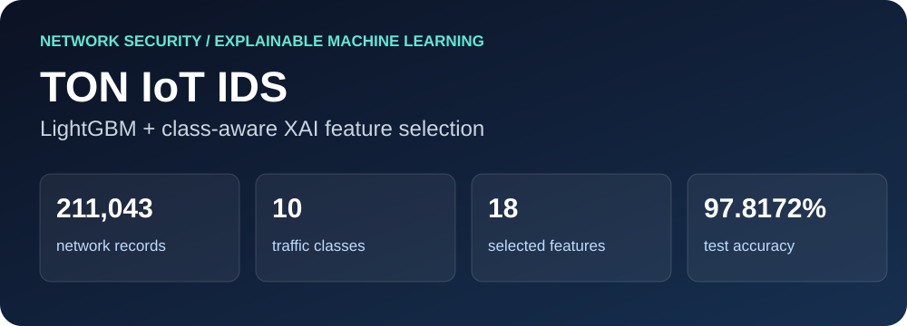
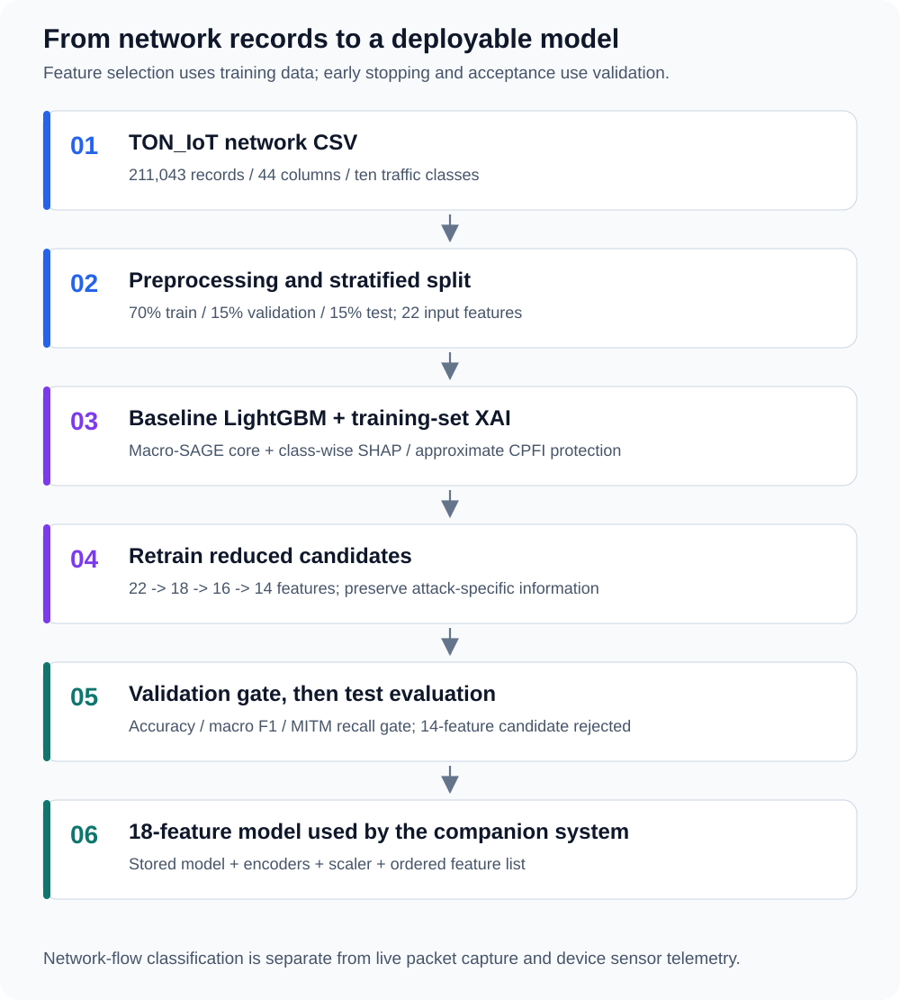
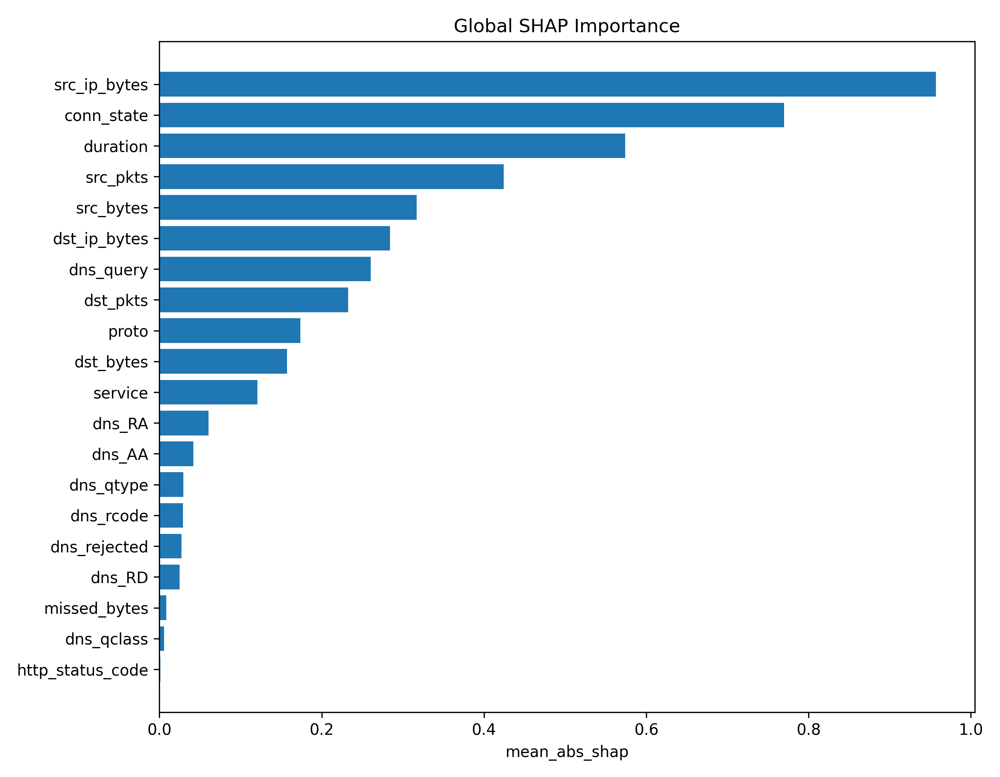

<p align="center">
  
</p>

<p align="center">
  <a href="README.ko.md">한국어</a> · <b>English</b> ·
  <a href="#results">Results</a> ·
  <a href="#quick-start">Quick start</a> ·
  <a href="https://github.com/M3rcy1028/zt-iot-security">Companion security system</a>
</p>

<p align="center">
  
  
  
</p>

## What this repository does

This repository trains and evaluates **LightGBM intrusion detection models on TON_IoT network-flow records**. It combines a Macro-SAGE feature core, class-wise SHAP, and approximate conditional permutation feature importance (CPFI) to reduce model inputs while retaining information needed by individual attack classes.

The research question is practical: **can fewer network features preserve detection quality while reducing the size and processing cost of the deployed model?** The archived experiment compares 22-, 18-, and 16-feature models and records why a further 14-feature reduction was rejected. The 18-feature model is used by the [Zero Trust IoT security system](https://github.com/M3rcy1028/zt-iot-security), where inference results inform device-specific access decisions.

> **Branch guide:** `xai` contains the training, XAI selection, and results documented here. The default `main` branch contains an earlier implementation and a landing page linking here. The benchmark artifacts below originate from commit [`c8cc8596`](https://github.com/M3rcy1028/toniot-ids/tree/c8cc8596f22900d994eca525878c8c674e2e98e4); subsequent documentation commits do not retrain the models.

## Experiment pipeline



1. Remove endpoint identifiers, ports, the binary target, and columns with at least 95% `-` values; replace remaining `-` values with `unknown`.
2. Shuffle and stratify the network CSV into training, validation, and test partitions. Fit categorical encoders and the MinMax scaler on training data.
3. Train a 22-feature LightGBM baseline. Calculate Macro-SAGE, class-wise SHAP, CPFI, and SHAP interaction reports using the training partition.
4. Retain globally useful features and protect attack-specific features, retrain reduced candidates, and apply the validation acceptance gate.
5. Evaluate accepted candidates on the saved test partition. Export the model, preprocessing artifacts, ordered feature list, predictions, and reports.

The high-missingness column filter currently runs **before** the split. Encoders and scaling are fitted on training data; validation controls early stopping and acceptance. See [evaluation scope](#evaluation-scope) for the implications of this setup.

## Dataset

The [official UNSW TON_IoT collection](https://research.unsw.edu.au/projects/toniot-datasets) contains network traffic, operating-system records, and IoT/IIoT telemetry. **This experiment uses the network CSV only**, obtained by the code from the [Kaggle mirror](https://www.kaggle.com/datasets/arnobbhowmik/ton-iot-network-dataset).

| Item | Configuration |
| --- | --- |
| Input file | `data_network/raw/train_test_network.csv` |
| CSV size | **211,043 records × 44 columns**, including targets |
| Prediction target | `type`: normal traffic + 9 attack classes |
| Training / validation / test | **147,729 / 31,657 / 31,657** records |
| Split | Stratified 70% / 15% / 15%; random seed `42` |
| Baseline → deployed inputs | **22 → 18** features |
| Other target | Binary `label` is excluded from the multiclass input |

These counts describe **this repository's CSV subset**, not the size of the complete TON_IoT collection.

| Class | CSV | Train | Validation | Test |
| --- | ---: | ---: | ---: | ---: |
| backdoor | 20,000 | 14,000 | 3,000 | 3,000 |
| ddos | 20,000 | 14,000 | 3,000 | 3,000 |
| dos | 20,000 | 14,000 | 3,000 | 3,000 |
| injection | 20,000 | 14,000 | 3,000 | 3,000 |
| mitm | 1,043 | 729 | 157 | 157 |
| normal | 50,000 | 35,000 | 7,500 | 7,500 |
| password | 20,000 | 14,000 | 3,000 | 3,000 |
| ransomware | 20,000 | 14,000 | 3,000 | 3,000 |
| scanning | 20,000 | 14,000 | 3,000 | 3,000 |
| xss | 20,000 | 14,000 | 3,000 | 3,000 |
| **Total** | **211,043** | **147,729** | **31,657** | **31,657** |


## XAI-guided feature selection

| Component | Role in selection |
| --- | --- |
| Macro-SAGE | Class-balanced aggregation of the repository's class-wise SAGE estimates; forms a global feature core |
| Class-wise SHAP | Identifies features contributing to each traffic class, beyond overall average importance |
| Approximate CPFI | Measures class-wise F1 changes after shuffling within groups defined by correlated conditioning features |
| SHAP interactions | Checks feature-pair contributions and supports class coverage in the selection procedure |
| LIME | Optional implementation; **disabled and excluded** from the archived automatic selection |

The first reduction uses the top 14 Macro-SAGE features as its core. Class-wise SHAP/CPFI candidate lists use top-12 rankings and a minimum coverage of three candidate features per class. CPFI uses five repetitions, two conditioning features, and five bins; SAGE uses one repetition. The resulting 18–20 feature candidate is retrained and checked on validation. Full settings: [`xai_config.json`](reports/lightgbm_260805/xai/reduction_1/xai_config.json).

### Final 18 input features

The [saved feature list](reports/lightgbm_260805/xai/reduction_1/selection/final_selected_features.csv) defines this exact model-input order:

```text
proto, service, duration, src_bytes, dst_bytes, conn_state,
src_pkts, src_ip_bytes, dst_pkts, dst_ip_bytes,
dns_query, dns_qclass, dns_qtype, dns_rcode,
dns_AA, dns_RD, dns_RA, dns_rejected
```

Relative to the 22-feature baseline, this removes `missed_bytes`, `http_request_body_len`, `http_response_body_len`, and `http_status_code`.

### Archived importance plots

These figures explain the **22-feature selection model before the first reduction**; they show its top 20 ranked features. They are offline selection evidence, rather than explanations generated for every request by the deployed model.





## Results

### Test-set classification

All rows below use the same **31,657-record test partition**. Precision, recall, and F1 are **unweighted macro averages over ten classes**. Classification values are percentages.

| Model | Inputs | Accuracy | Macro precision | Macro recall | Macro F1 |
| --- | ---: | ---: | ---: | ---: | ---: |
| Baseline | 22 | 97.7920 | 95.3154 | 95.2816 | 95.2795 |
| **Reduction 1 · deployed** | **18** | **97.8172** | **95.5566** | **95.6200** | **95.5692** |
| Reduction 2 | 16 | 97.8204 | 95.4429 | 95.6857 | 95.5419 |

Sources: [baseline metrics](reports/lightgbm_260805/metrics.csv), [18-feature metrics](reports/lightgbm_260805/reduction_1/metrics.csv), [16-feature metrics](reports/lightgbm_260805/reduction_2/metrics.csv).

### Model size and batch processing

| Model | Stored model (B) | Batch time (s) | Amortized time (ms/record) | Throughput (records/s) |
| --- | ---: | ---: | ---: | ---: |
| Baseline · 22 | 8,152,020 | 2.3505 | 0.07425 | 13,468.34 |
| **Reduction 1 · 18** | **7,273,284** | **2.0422** | **0.06451** | **15,501.44** |
| Reduction 2 · 16 | 7,853,780 | 2.1702 | 0.06855 | 14,587.09 |

**Timing definition:** `evaluate_model()` measures both `predict(X_test)` **and** `predict_proba(X_test)` in the same timed block. Per-record time is the full-batch time divided by 31,657; it is **not** single-request latency, feature extraction time, or ESP32-to-server communication delay. These are archived measurements, not new benchmarks on the reader's machine.


**Result analysis.** The 18-feature model reduces the input count by **18.18%**, stored model size by **10.78%**, and recorded batch evaluation time by **13.12%** relative to the baseline. Accuracy increases by 0.0253 percentage points and Macro F1 by 0.2897 percentage points. The 16-feature model has slightly higher accuracy—one additional correct test prediction—but the 18-feature model has higher Macro F1 and a smaller, faster stored model in this run. The companion system uses the 18-feature model for this tradeoff. Fewer inputs do not automatically produce fewer trees: the saved 22/18/16-feature models stop at 227/203/219 boosting rounds, respectively.

### Validation acceptance and further reduction

Each candidate is compared with its **preceding stage** on validation. The maximum permitted decreases are **0.1 percentage point in Accuracy**, **0.2 in Macro F1**, and **1.0 in MITM recall**.

| Candidate | Inputs | Validation Accuracy (%) | Validation Macro F1 (%) | Validation MITM recall (%) | Gate |
| --- | ---: | ---: | ---: | ---: | --- |
| Baseline | 22 | 98.0257 | 95.8059 | 78.9809 | Reference |
| Reduction 1 | 18 | 98.0131 | 95.7370 | 78.3439 | Accepted |
| Reduction 2 | 16 | 98.0320 | 95.8986 | 79.6178 | Accepted |
| Reduction 3 | 14 | 97.9941 | 95.7218 | 78.3439 | **Rejected** |

The 14-feature candidate loses **1.2739 percentage points of MITM recall** relative to 16 features, exceeding the gate. Its test result and model artifact were not exported. Both 18 and 16 features pass the gate; the companion system's deployment choice is separate from validation acceptance. See the [stage 1](reports/lightgbm_260805/reduction_1/acceptance_decision.csv), [stage 2](reports/lightgbm_260805/reduction_2/acceptance_decision.csv), and [stage 3](reports/lightgbm_260805/reduction_3/acceptance_decision.csv) decision records.

### Per-class performance · deployed model

| Class | Precision (%) | Recall (%) | F1 (%) | Test support |
| --- | ---: | ---: | ---: | ---: |
| backdoor | 99.9667 | 100.0000 | 99.9833 | 3,000 |
| ddos | 99.0863 | 97.6000 | 98.3375 | 3,000 |
| dos | 99.0903 | 98.0333 | 98.5590 | 3,000 |
| injection | 98.3034 | 96.5667 | 97.4273 | 3,000 |
| mitm | 76.2500 | 77.7070 | 76.9716 | 157 |
| normal | 99.6006 | 99.7600 | 99.6803 | 7,500 |
| password | 99.3579 | 98.0000 | 98.6743 | 3,000 |
| ransomware | 90.8557 | 98.0333 | 94.3082 | 3,000 |
| scanning | 98.6415 | 99.2333 | 98.9365 | 3,000 |
| xss | 94.4138 | 91.2667 | 92.8136 | 3,000 |

The model correctly classifies **30,966 / 31,657** records. MITM has only 157 test examples and remains the weakest class. The largest off-diagonal count is 220 XSS records classified as ransomware. The normalized matrix makes minority-class recall visible alongside the [original count matrix](reports/lightgbm_260805/reduction_1/confusion_matrix.png) and [CSV](reports/lightgbm_260805/reduction_1/confusion_matrix.csv).


## Quick start

### 1. Get the experiment branch and install dependencies

```bash
git clone --branch xai --single-branch --depth 1 https://github.com/M3rcy1028/toniot-ids.git
cd toniot-ids
```

Windows PowerShell:

```powershell
py -3.14 -m venv .venv
.\.venv\Scripts\Activate.ps1
python -m pip install -r requirements-toniot.txt
```

Linux/macOS, with Python 3.14 installed:

```bash
python3.14 -m venv .venv
source .venv/bin/activate
python -m pip install -r requirements-toniot.txt
```

CPython **3.14.4** was verified for model loading and inference in the companion system. The archived training run's exact interpreter and complete machine configuration were not captured; package pins below describe the repository environment, not a guarantee of identical wall-clock times.

| Package | Version | Package | Version |
| --- | --- | --- | --- |
| lightgbm | 4.6.0 | scikit-learn | 1.8.0 |
| numpy | 2.4.3 | pandas | 3.0.1 |
| joblib | 1.5.3 | matplotlib | 3.10.8 |
| shap | 0.51.0 | sage-importance | 0.0.6 |
| lime | 0.2.0.1 | kagglehub | 1.0.1 |

### 2. Use the saved model without retraining

Run this Python snippet from the repository root. `X_test.csv` is **already encoded and scaled**; do not preprocess it again.

```python
from pathlib import Path
import joblib
import pandas as pd

report = Path("reports/lightgbm_260805")
model = joblib.load("models/lightgbm_toniot_classification_reduction_1.pkl")
target = joblib.load("data_network/processed_type/target_encoder.pkl")
features = pd.read_csv(
    report / "xai/reduction_1/selection/final_selected_features.csv"
)["feature"].tolist()
X = pd.read_csv("data_network/processed_type/X_test.csv", nrows=5)[features]
labels = target.inverse_transform(model.predict(X).astype(int))
probabilities = model.predict_proba(X)
print(pd.DataFrame({"label": labels, "confidence": probabilities.max(axis=1)}))
```

The `.pkl` file contains the **trained tree ensemble**, not just a weight array. Raw network fields must first use the saved `label_encoders.pkl` and `minmax_scaler.pkl`, then be selected in the exact 18-feature order. The [companion server's adapter and setup documentation](https://github.com/M3rcy1028/zt-iot-security) implement this online path.

### 3. Reproduce the offline training stages

Use a fresh working copy: training writes model filenames under `models/` and reports under `reports/lightgbm_YYMMDD/`. Full-training-set XAI can take substantially longer than plain model fitting.

```bash
# Baseline only, without the XAI pass.
python -c "from experiment import run_lightgbm_pipeline; run_lightgbm_pipeline(save_results=True, feature_selection=False, run_xai=False)"

# Run reductions in order. Each stage uses the preceding stage's daily artifacts.
python run_reduction_1.py
python run_reduction_2.py
python run_reduction_3.py
```

The current scripts resolve report directories using the date at process startup. Run dependent stages with the same date context; a stage started after midnight looks in the new day's directory. The archived `lightgbm_260805` folder remains the source of the README results.

The pipeline reuses saved processed CSVs when they exist. To explicitly rebuild them from the network CSV:

```bash
python -c "from toniot_dataset import ensure_raw_dataset, preprocess_dataset; ensure_raw_dataset(); preprocess_dataset()"
```

If the raw CSV is absent, `ensure_raw_dataset()` downloads the configured Kaggle mirror; access may require Kaggle credentials. `python run.py` is another entry point, but runs baseline **and XAI** by default. Its boolean options use `type=bool`; use the explicit function call above to disable XAI reliably.

### 4. Audit archived results and regenerate README figures

```bash
python docs/tools/build_readme_assets.py
```

This verifies all three saved prediction files against their confusion matrices and macro metrics, counts dataset partitions, hashes model files, and recreates the documentation assets. It **does not train models or measure new inference times**. Machine-readable output: [`docs/research_summary.json`](docs/research_summary.json).

## Model configuration and repository map

The classifier uses multiclass GBDT, up to 3,000 boosting rounds, learning rate `0.05`, `31` leaves, maximum depth `15`, feature fraction `0.8`, seed `42`, and `8` CPU threads. Validation `multi_logloss` controls early stopping with patience `50`. The constructor also sets `subsample=0.8`, but leaves `subsample_freq=0`, so row bagging is not activated. See [`lightgbm_model.py`](lightgbm_model.py).

```text
toniot-ids/
├── toniot_dataset.py        # Download, split, encoding, scaling
├── lightgbm_model.py        # LightGBM construction, fitting, persistence
├── experiment.py            # Baseline, reductions, validation gates, evaluation
├── xai.py                   # Class-wise importance, interactions, consensus selection
├── run.py                   # Baseline + optional feature-selected entry point
├── run_reduction_{1,2,3}.py  # Sequential reduction experiments
├── requirements-toniot.txt  # Pinned experiment dependencies
├── data_network/            # Current raw network CSV and processed_type partitions
├── models/                  # Saved full and reduced tree ensembles
├── reports/lightgbm_260805/  # Archived metrics, predictions, XAI, selection evidence
└── docs/                    # Aggregate audit and reproducible README assets
```

Historical `data/processed_label` / `data/processed_type` directories belong to earlier experiments. The current multiclass pipeline reads **`data_network/processed_type`**.

## Evaluation scope

- This is supervised classification of recorded network features, not proof of live packet capture, raw sensor-telemetry anomaly detection, or generalization to unseen deployments.
- The split is row-wise stratified, not a device-, time-, or site-held-out evaluation. The global 95% missingness filter precedes the split; strict inductive evaluation should fit that filter on training data too.
- Selection/gating uses training and validation, but the deployment comparison also reports multiple candidates on the same test partition. A further untouched external set is needed for an independent estimate after final model selection.
- CPFI uses grouped shuffling as an approximation to conditional sampling. One SAGE repeat and a single archived timing run do not establish selection uncertainty or timing confidence intervals.
- Macro scores and per-class support matter because MITM is rare. Aggregate accuracy alone does not describe that class's detection quality.

## References and related implementation

- [UNSW TON_IoT dataset provider and required dataset publications](https://research.unsw.edu.au/projects/toniot-datasets). Please follow the provider's citation and data-use requirements; the download mirror is not the original creator.
- [LightGBM 4.6.0 documentation and implementation](https://lightgbm.readthedocs.io/en/v4.6.0/).
- [SHAP documentation](https://shap.readthedocs.io/en/stable/) and [SAGE authors' reference implementation](https://github.com/iancovert/sage). The class-wise SAGE aggregation and consensus selection used here are implemented in this repository's `xai.py`.
- [LIME authors' implementation](https://github.com/marcotcr/lime), available as an optional explanation path.
- [Zero Trust IoT security system](https://github.com/M3rcy1028/zt-iot-security): authenticated device-to-gateway communication, protected server inference, and device-risk policy enforcement using this model.
