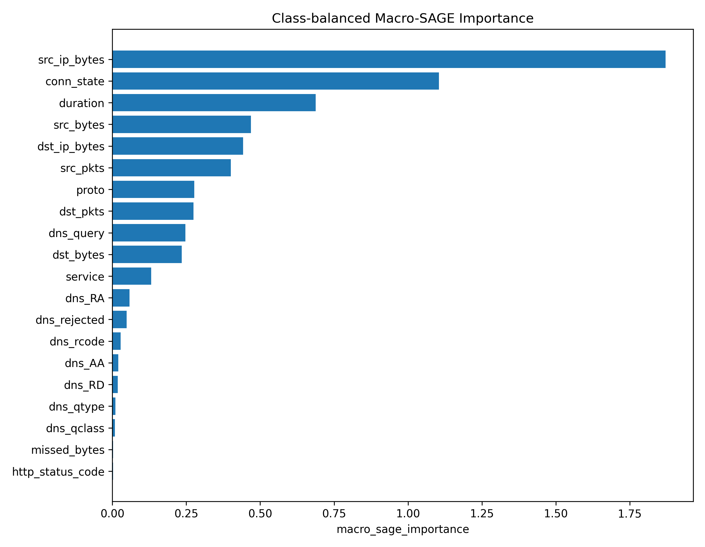
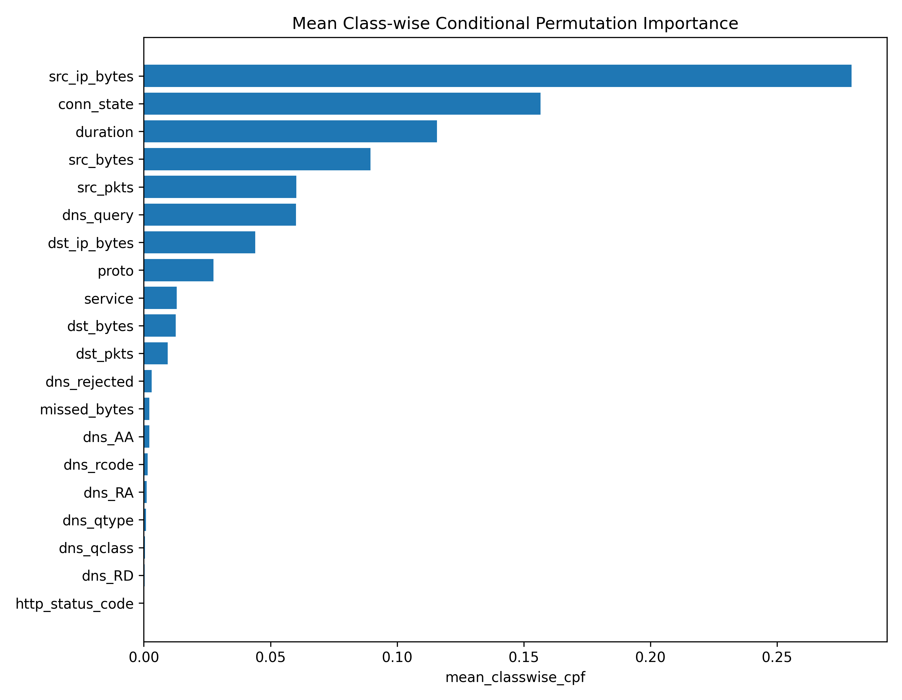

<p align="center">
  
</p>

<p align="center">
  <a href="README.ko.md">한국어</a> · <b>English</b> ·
  <a href="#results">Results</a> ·
  <a href="#quick-start">Quick start</a> ·
  <a href="https://github.com/M3rcy1028/zt-iot-security">Companion security system</a>
</p>

<p align="center">
  
  
  
</p>

## What this repository does

This repository provides training, analysis, and evaluation code for **LightGBM intrusion detection on TON_IoT network data**. Macro-SAGE, class-wise SHAP, and approximate conditional permutation feature importance (CPFI) select a smaller input set while preserving features needed by individual attack classes.

The goal is to **retain detection quality while reducing input features, model size, and processing cost**. Experiments compare 22-, 18-, and 16-feature models and examine the effect of reducing the input to 14 features. The final 18-feature model supplies inference results to the [Zero Trust IoT security system](https://github.com/M3rcy1028/zt-iot-security) for device-specific access control.

## Experiment pipeline


1. Remove endpoint identifiers, ports, the binary target, and columns with at least 95% `-` values; replace remaining `-` values with `unknown`.
2. Shuffle and stratify the network CSV into training, validation, and test partitions. Fit categorical encoders and the MinMax scaler on training data.
3. Train a 22-feature LightGBM baseline. Calculate Macro-SAGE, class-wise SHAP, CPFI, and SHAP interaction reports using the training partition.
4. Retain globally useful features and protect attack-specific features, retrain reduced candidates, and apply the validation acceptance gate.
5. Evaluate accepted candidates on the test set. Export the model, preprocessing files, feature order, predictions, and reports.

## Dataset

The [official UNSW TON_IoT collection](https://research.unsw.edu.au/projects/toniot-datasets) contains network traffic, operating-system records, and IoT/IIoT telemetry. **This experiment uses the network CSV only**, obtained by the code from the [Kaggle mirror](https://www.kaggle.com/datasets/arnobbhowmik/ton-iot-network-dataset).

| Item | Configuration |
| --- | --- |
| Input file | `data_network/raw/train_test_network.csv` |
| CSV size | **211,043 records × 44 columns**, including targets |
| Prediction target | `type`: normal traffic + 9 attack classes |
| Training / validation / test | **147,729 / 31,657 / 31,657** records |
| Split | Stratified 70% / 15% / 15%; random seed `42` |
| Baseline → deployed inputs | **22 → 18** features |
| Other target | Binary `label` is excluded from the multiclass input |

| Class | CSV | Train | Validation | Test |
| --- | ---: | ---: | ---: | ---: |
| backdoor | 20,000 | 14,000 | 3,000 | 3,000 |
| ddos | 20,000 | 14,000 | 3,000 | 3,000 |
| dos | 20,000 | 14,000 | 3,000 | 3,000 |
| injection | 20,000 | 14,000 | 3,000 | 3,000 |
| mitm | 1,043 | 729 | 157 | 157 |
| normal | 50,000 | 35,000 | 7,500 | 7,500 |
| password | 20,000 | 14,000 | 3,000 | 3,000 |
| ransomware | 20,000 | 14,000 | 3,000 | 3,000 |
| scanning | 20,000 | 14,000 | 3,000 | 3,000 |
| xss | 20,000 | 14,000 | 3,000 | 3,000 |
| **Total** | **211,043** | **147,729** | **31,657** | **31,657** |


## XAI-guided feature selection

| Component | Role in selection |
| --- | --- |
| Macro-SAGE | Class-balanced aggregation of the repository's class-wise SAGE estimates; forms a global feature core |
| Class-wise SHAP | Identifies features contributing to each traffic class, beyond overall average importance |
| Approximate CPFI | Measures class-wise F1 changes after shuffling within groups defined by correlated conditioning features |
| SHAP interactions | Checks feature-pair contributions and supports class coverage in the selection procedure |
| LIME | Optional explanation method; experiment setting: `enable_lime=false` |

The first reduction uses the top 14 Macro-SAGE features as its core. Class-wise SHAP/CPFI candidate lists use top-12 rankings and a minimum coverage of three candidate features per class. CPFI uses five repetitions, two conditioning features, and five bins; SAGE uses one repetition. The resulting 18–20 feature candidate is retrained and checked on validation. Full settings: [`xai_config.json`](reports/lightgbm_260805/xai/reduction_1/xai_config.json).

### Final 18 input features

The [feature list](reports/lightgbm_260805/xai/reduction_1/selection/final_selected_features.csv) defines the model-input order:

```text
proto, service, duration, src_bytes, dst_bytes, conn_state,
src_pkts, src_ip_bytes, dst_pkts, dst_ip_bytes,
dns_query, dns_qclass, dns_qtype, dns_rcode,
dns_AA, dns_RD, dns_RA, dns_rejected
```

Relative to the 22-feature baseline, this removes `missed_bytes`, `http_request_body_len`, `http_response_body_len`, and `http_status_code`.

### Feature importance

The following plots compare the top 20 features of the **22-feature model used for the first reduction**.






## Results

### Test-set classification

All models use the same **31,657-record test set**. Precision, recall, and F1 are macro averages over ten classes. (Unit: %)

| Model | Inputs | Accuracy | Macro precision | Macro recall | Macro F1 |
| --- | ---: | ---: | ---: | ---: | ---: |
| Baseline | 22 | 97.7920 | 95.3154 | 95.2816 | 95.2795 |
| **Reduction 1 · deployed** | **18** | **97.8172** | **95.5566** | **95.6200** | **95.5692** |
| Reduction 2 | 16 | 97.8204 | 95.4429 | 95.6857 | 95.5419 |

Sources: [baseline metrics](reports/lightgbm_260805/metrics.csv), [18-feature metrics](reports/lightgbm_260805/reduction_1/metrics.csv), [16-feature metrics](reports/lightgbm_260805/reduction_2/metrics.csv).

### Model size and batch processing

| Model | Model size (B) | Batch time (s) | Time/sample (ms) | Throughput (samples/s) |
| --- | ---: | ---: | ---: | ---: |
| Baseline · 22 | 8,152,020 | 2.3505 | 0.07425 | 13,468.34 |
| **Reduction 1 · 18** | **7,273,284** | **2.0422** | **0.06451** | **15,501.44** |
| Reduction 2 · 16 | 7,853,780 | 2.1702 | 0.06855 | 14,587.09 |

`Batch time` measures `predict(X_test)` and `predict_proba(X_test)` together. `Time/sample` divides that measurement by 31,657.


**Result analysis:** The 18-feature model reduces input count by **18.18%**, model size by **10.78%**, and batch time by **13.12%** relative to the baseline. Accuracy increases by 0.0253 percentage points and Macro F1 by 0.2897 percentage points. The 16-feature model makes one more correct prediction, while the 18-feature model achieves higher Macro F1, a smaller model file, and lower processing time. The companion system therefore uses 18 features. Early stopping occurs at 227, 203, and 219 rounds for the 22-, 18-, and 16-feature models, respectively.

### Validation acceptance and further reduction

Each candidate is compared with its **preceding stage** on validation. The maximum permitted decreases are **0.1 percentage point in Accuracy**, **0.2 in Macro F1**, and **1.0 in MITM recall**.

| Candidate | Inputs | Validation Accuracy (%) | Validation Macro F1 (%) | Validation MITM recall (%) | Gate |
| --- | ---: | ---: | ---: | ---: | --- |
| Baseline | 22 | 98.0257 | 95.8059 | 78.9809 | Reference |
| Reduction 1 | 18 | 98.0131 | 95.7370 | 78.3439 | Accepted |
| Reduction 2 | 16 | 98.0320 | 95.8986 | 79.6178 | Accepted |
| Reduction 3 | 14 | 97.9941 | 95.7218 | 78.3439 | **Rejected** |

The 14-feature candidate loses **1.2739 percentage points of MITM recall** relative to 16 features and fails the gate. Both the 18- and 16-feature candidates pass; the final deployment choice compares their classification performance and resource cost. Decisions: [stage 1](reports/lightgbm_260805/reduction_1/acceptance_decision.csv) · [stage 2](reports/lightgbm_260805/reduction_2/acceptance_decision.csv) · [stage 3](reports/lightgbm_260805/reduction_3/acceptance_decision.csv)

### Per-class performance · deployed model

| Class | Precision (%) | Recall (%) | F1 (%) | Test support |
| --- | ---: | ---: | ---: | ---: |
| backdoor | 99.9667 | 100.0000 | 99.9833 | 3,000 |
| ddos | 99.0863 | 97.6000 | 98.3375 | 3,000 |
| dos | 99.0903 | 98.0333 | 98.5590 | 3,000 |
| injection | 98.3034 | 96.5667 | 97.4273 | 3,000 |
| mitm | 76.2500 | 77.7070 | 76.9716 | 157 |
| normal | 99.6006 | 99.7600 | 99.6803 | 7,500 |
| password | 99.3579 | 98.0000 | 98.6743 | 3,000 |
| ransomware | 90.8557 | 98.0333 | 94.3082 | 3,000 |
| scanning | 98.6415 | 99.2333 | 98.9365 | 3,000 |
| xss | 94.4138 | 91.2667 | 92.8136 | 3,000 |

The model correctly classifies **30,966 / 31,657** records. MITM has 157 test examples and the lowest class-level performance. The most frequent error is 220 XSS records classified as ransomware. The row-normalized confusion matrix is shown below; the [count matrix](reports/lightgbm_260805/reduction_1/confusion_matrix.png) and [CSV](reports/lightgbm_260805/reduction_1/confusion_matrix.csv) provide the underlying counts.


## Quick start

### 1. Download and install dependencies

```bash
git clone https://github.com/M3rcy1028/toniot-ids.git
cd toniot-ids
```

Windows PowerShell:

```powershell
py -3.14 -m venv .venv
.\.venv\Scripts\Activate.ps1
python -m pip install -e .
```

Linux/macOS, with Python 3.14 installed:

```bash
python3.14 -m venv .venv
source .venv/bin/activate
python -m pip install -e .
```

Model loading and inference use **CPython 3.14.4**. Dependencies are pinned in `requirements-toniot.txt`.

`python -m toniot_ids --help` lists all commands. Installation also provides the equivalent `toniot-ids` command.

| Package | Version | Package | Version |
| --- | --- | --- | --- |
| lightgbm | 4.6.0 | scikit-learn | 1.8.0 |
| numpy | 2.4.3 | pandas | 3.0.1 |
| joblib | 1.5.3 | matplotlib | 3.10.8 |
| shap | 0.51.0 | sage-importance | 0.0.6 |
| lime | 0.2.0.1 | kagglehub | 1.0.1 |

### 2. Run the trained model

Run this snippet from the repository root. The example uses the encoded and scaled `X_test.csv`.

```python
from pathlib import Path
import joblib
import pandas as pd

report = Path("reports/lightgbm_260805")
model = joblib.load("models/lightgbm_toniot_classification_reduction_1.pkl")
target = joblib.load("data_network/processed_type/target_encoder.pkl")
features = pd.read_csv(
    report / "xai/reduction_1/selection/final_selected_features.csv"
)["feature"].tolist()
X = pd.read_csv("data_network/processed_type/X_test.csv", nrows=5)[features]
labels = target.inverse_transform(model.predict(X).astype(int))
probabilities = model.predict_proba(X)
print(pd.DataFrame({"label": labels, "confidence": probabilities.max(axis=1)}))
```

The `.pkl` contains the **trained LightGBM tree ensemble and model configuration**. For raw input, apply `label_encoders.pkl` and `minmax_scaler.pkl`, then select the 18 features in model-input order. See the [companion server's adapter and setup](https://github.com/M3rcy1028/zt-iot-security) for online inference.

### 3. Reproduce the offline training stages

Run training in a separate clone. Models are written to `models/`, and experiment outputs to the date-based `reports/lightgbm_YYMMDD/` directory.

```bash
# Baseline training and evaluation without the XAI pass
python -m toniot_ids baseline --no-xai

# Run all reduction stages in order
python -m toniot_ids reduce all
```

`reduce all` runs the stages in one process and stops when a candidate fails validation. Use `reduce 1`, `reduce 2`, or `reduce 3` for an individual stage. Independent invocations use date-based report directories. The results in this README are in `reports/lightgbm_260805/`.

Use `python -m toniot_ids --workspace /path/to/experiment baseline --no-xai` to read `data_network/` and write `models/` and `reports/` in another directory.

The pipeline reuses saved processed CSVs when they exist. To explicitly rebuild them from the network CSV:

```bash
python -m toniot_ids preprocess
```

If the raw CSV is absent, preprocessing downloads it from the Kaggle mirror. Configure Kaggle credentials locally. `baseline` includes XAI by default; `--no-xai` selects baseline-only training. `baseline --features path/to/features.csv` selects inputs from a CSV with a `feature` column. `python -m toniot_ids analyze` generates descriptive statistics.

### 4. Verify results and generate figures

```bash
python docs/tools/build_readme_assets.py
```

This checks all three prediction files against their confusion matrices and macro metrics, counts dataset partitions, verifies model SHA-256 values, and generates figures from the experiment outputs. Summary: [`docs/research_summary.json`](docs/research_summary.json).

## Model configuration and repository map

The classifier uses multiclass GBDT, up to 3,000 boosting rounds, learning rate `0.05`, `num_leaves=31`, `max_depth=15`, `colsample_bytree=0.8`, random seed `42`, and `8` CPU threads. Validation `multi_logloss` controls early stopping with patience `50`. Row-bagging settings are `subsample=0.8` and `subsample_freq=0`. Full configuration: [`toniot_ids/model.py`](toniot_ids/model.py)

```text
toniot-ids/
├── pyproject.toml          # Package metadata and CLI installation
├── requirements-toniot.txt # Pinned experiment dependencies
├── toniot_ids/
│   ├── cli.py              # preprocess / analyze / baseline / reduce
│   ├── data.py             # Download, split, encoding, scaling
│   ├── model.py            # LightGBM construction, fitting, persistence
│   ├── experiments.py      # Baseline, reductions, acceptance gates, evaluation
│   └── xai.py              # Feature importance and consensus selection
├── experiments/telemetry/  # Independent sensor-data preprocessing
├── tests/                  # CLI workflow integration checks
├── data_network/           # Network CSV and processed data
├── data_iot/               # IoT telemetry experiment data
├── models/                 # Trained models
├── reports/                # Metrics, predictions, XAI results
└── docs/
    ├── experiments/        # Experiment logs and research notes
    ├── figures/            # Detailed pipeline and SVG source
    ├── assets/             # README figures
    └── tools/              # Result verification and visualization
```

Network experiments read `data_network/processed_type`. See [experiment logs and notes](docs/experiments/README.md) and the [detailed pipeline figure](docs/figures/README.md).

Run the integration checks with `python -m unittest discover -s tests -v`. They preprocess a small fixture, train a real LightGBM model, and verify its serialized predictions inside a temporary workspace.

## References and related implementation

- [UNSW TON_IoT](https://research.unsw.edu.au/projects/toniot-datasets): dataset description and original publications
- [LightGBM 4.6.0](https://lightgbm.readthedocs.io/en/v4.6.0/): implementation and parameter reference
- [SHAP](https://shap.readthedocs.io/en/stable/) · [SAGE](https://github.com/iancovert/sage) · [LIME](https://github.com/marcotcr/lime): original publications and reference implementations
- [Zero Trust IoT security system](https://github.com/M3rcy1028/zt-iot-security): authenticated communications, server inference, and device-risk access control

## License

Project code and documentation use the [MIT License](LICENSE). TON_IoT data and external dependencies retain their own terms; see [Third-party notices](THIRD_PARTY_NOTICES.md).

## Limitations and untested scenarios

- No live packet capture, raw sensor-telemetry detection, or external-deployment evaluation
- Row-wise stratified split; no device-, time-, or site-held-out evaluation
- Global 95% missingness filter applied before splitting; no train-only filter comparison
- Multiple candidates compared on the same test set for deployment selection; no independent post-selection external test
- Grouped-shuffle CPFI approximation, one SAGE repeat, no feature-selection stability or timing confidence-interval study
- Offline XAI feature selection; no per-request online explanations
- Batch timing excludes single-request latency, feature extraction, and device-to-server communication
- The 14-feature candidate fails validation; no test metrics or model export for that candidate
- Incomplete records of the original training interpreter and hardware
