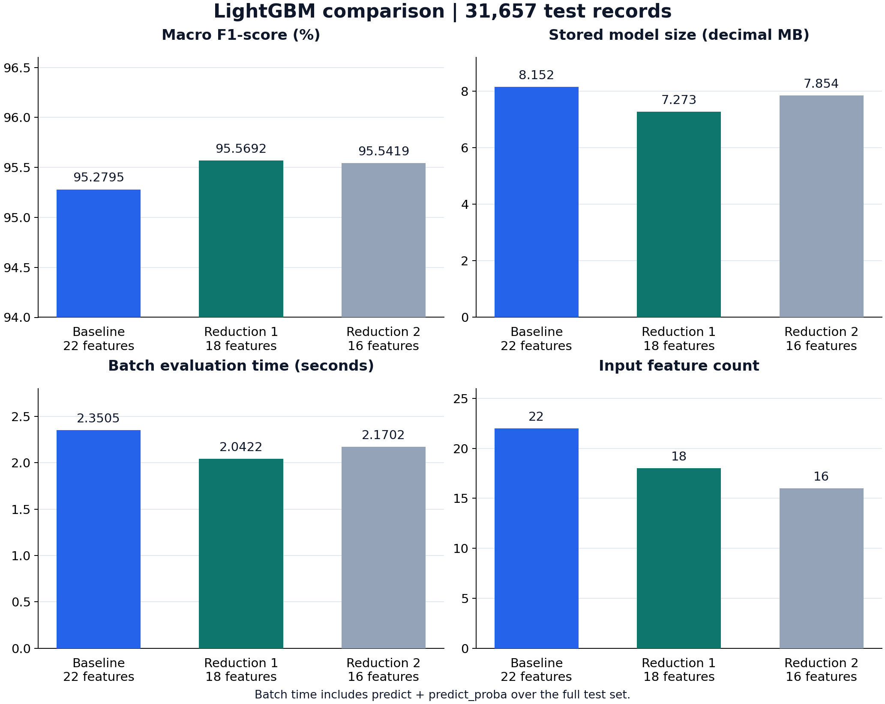

<p align="center">
  
</p>

<p align="center">
  <a href="README.ko.md">한국어</a> · <b>English</b> ·
  <a href="https://github.com/M3rcy1028/toniot-ids/blob/xai/README.md#results">Results</a> ·
  <a href="https://github.com/M3rcy1028/zt-iot-security">Companion system</a>
</p>

## Explainable intrusion detection for IoT networks

This project trains LightGBM classifiers on TON_IoT network-flow records and uses **Macro-SAGE, class-wise SHAP, and approximate CPFI** to reduce input features while preserving information needed by individual attack classes. The resulting model supplies inference results to a [Zero Trust IoT security system](https://github.com/M3rcy1028/zt-iot-security).

| Explore | Link |
| --- | --- |
| English experiment guide | [Full README](https://github.com/M3rcy1028/toniot-ids/blob/xai/README.md) |
| 한국어 실험 안내 | [README.ko.md](https://github.com/M3rcy1028/toniot-ids/blob/xai/README.ko.md) |
| Dataset, splits, and class distribution | [Dataset](https://github.com/M3rcy1028/toniot-ids/blob/xai/README.md#dataset) |
| Train or run the model | [Quick start](https://github.com/M3rcy1028/toniot-ids/blob/xai/README.md#quick-start) |
| Experiment summary | [Research summary](https://github.com/M3rcy1028/toniot-ids/blob/xai/docs/research_summary.json) |
| Deployment model | [18-feature LightGBM ensemble](https://github.com/M3rcy1028/toniot-ids/blob/xai/models/lightgbm_toniot_classification_reduction_1.pkl) |

```bash
git clone --branch xai --single-branch --depth 1 https://github.com/M3rcy1028/toniot-ids.git
cd toniot-ids
```

Follow the [setup and execution instructions](https://github.com/M3rcy1028/toniot-ids/blob/xai/README.md#quick-start). Dependencies are pinned in `requirements-toniot.txt`; model loading and inference use CPython 3.14.4.

## Dataset and results

The experiment uses a network CSV from [TON_IoT](https://research.unsw.edu.au/projects/toniot-datasets): **211,043 records, 44 columns, and ten classes**, divided by stratified split into **147,729 / 31,657 / 31,657** training, validation, and test records.

F1 is the ten-class macro average. (Classification scores: %)

| Model | Inputs | Test Accuracy | Test Macro F1 | Model size (B) | Batch time (s) |
| --- | ---: | ---: | ---: | ---: | ---: |
| Baseline | 22 | 97.7920 | 95.2795 | 8,152,020 | 2.3505 |
| **Deployed** | **18** | **97.8172** | **95.5692** | **7,273,284** | **2.0422** |
| Further reduction | 16 | 97.8204 | 95.5419 | 7,853,780 | 2.1702 |



The 18-feature model uses **18.18% fewer inputs**, a **10.78% smaller model file**, and **13.12% less batch evaluation time** than the baseline, while improving Macro F1 by 0.2897 percentage points. The 16-feature model has slightly higher accuracy; the companion system uses 18 features for its Macro F1, size, and processing-time tradeoff. Batch timing includes **both `predict` and `predict_proba` on 31,657 records**.

See the [full results](https://github.com/M3rcy1028/toniot-ids/blob/xai/README.md#results) for per-class metrics, confusion matrices, feature importance, and validation decisions.

## Related implementation

- [TON_IoT](https://research.unsw.edu.au/projects/toniot-datasets): dataset description and original publications
- [Training and evaluation](https://github.com/M3rcy1028/toniot-ids/blob/xai/README.md): preprocessing, XAI, models, and experiment outputs
- [Zero Trust IoT security system](https://github.com/M3rcy1028/zt-iot-security): authentication, protected communications, server inference, and device-risk access control

## License

Project code and documentation use the [MIT License](LICENSE). Dataset and dependency terms are listed in [Third-party notices](THIRD_PARTY_NOTICES.md).

## Limitations and untested scenarios

- Offline network-data classification with a row-wise stratified split
- No live packet capture, raw sensor-telemetry detection, or external-deployment evaluation
- Batch time excludes feature extraction and network communication; single-request latency not measured
- No independent external test after comparing candidate models on the same test partition
- The 14-feature candidate fails validation; no test result or model export
- Incomplete records of the original training interpreter and hardware
- [Full experiment notes](https://github.com/M3rcy1028/toniot-ids/blob/xai/README.md#limitations-and-untested-scenarios)
